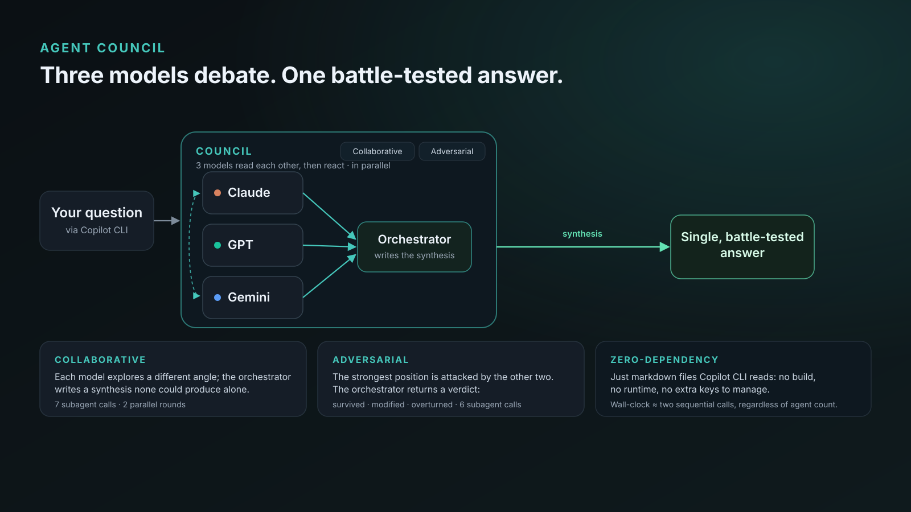
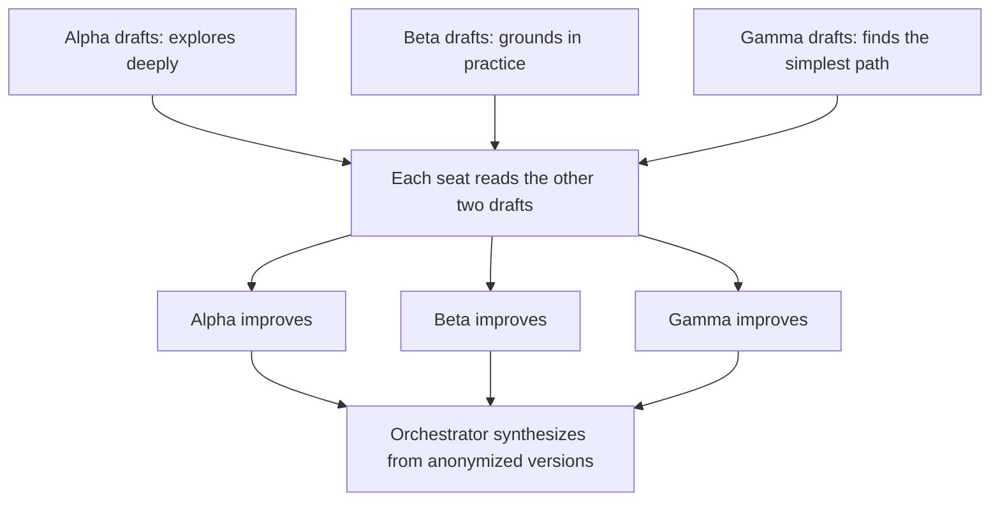
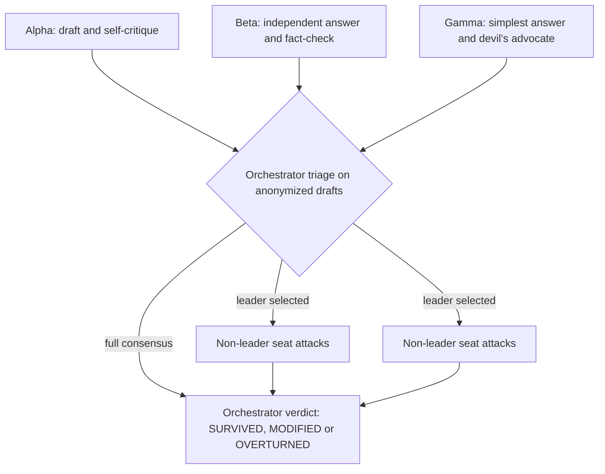
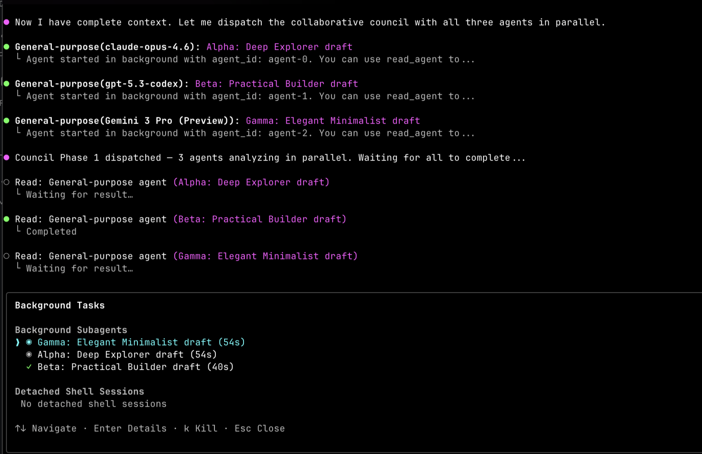

# AgentCouncil



AgentCouncil is a plugin for [GitHub Copilot CLI](https://docs.github.com/en/copilot/how-tos/copilot-cli/) that puts a hard question to three models from different families at the same time. The models either build on each other's work or attack the strongest answer, and an orchestrator writes the final result.

- **Collaborative mode** (default): each seat drafts, reads the other drafts, and improves its own. The orchestrator writes a synthesis.
- **Adversarial mode**: each seat drafts, the orchestrator picks the leading answer, the other two attack it, and the orchestrator rules on it.
- **Light or full effort**: simple questions get a quick 4-call pass. Hard ones get the full 5 to 7-call protocol.

## Why three model families

A single model sounds confident even when it is wrong, and it rarely questions its own assumptions. Models from different vendors are trained differently and fail differently. Running one model from each family in parallel, then making them interact once, catches mistakes that any one of them would miss.

The orchestrator only sees anonymized, reordered responses (Response A, B, C), so it cannot favor the seat that shares its model family.

## Install

Requirements: GitHub Copilot CLI, signed in, with access to models from at least two of the families in the [roster](#models).

```bash
copilot plugin marketplace add Sentry01/AgentCouncil
copilot plugin install agentcouncil@agentcouncil
```

Update to the latest release ([release notes](https://github.com/Sentry01/AgentCouncil/releases)). The marketplace pins each version to its release tag, so you only receive published releases, never unreleased work on `main`:

```bash
copilot plugin marketplace update agentcouncil
copilot plugin update agentcouncil@agentcouncil
```

Remove:

```bash
copilot plugin uninstall agentcouncil@agentcouncil
```

You can also install straight from the repository with `copilot plugin install Sentry01/AgentCouncil` and update it with `copilot plugin update agentcouncil`. That route tracks `main`, including unreleased changes. Use the marketplace route above to stay on releases.

### Upgrading from 1.x

Version 2.0.0 renames the plugin to `agentcouncil` and changes the agent ID. Remove the old copies first so they do not load twice:

```bash
copilot plugin uninstall agent-council                          # if you installed 1.x as a plugin
rm -rf ~/.copilot/skills/agent-council ~/.copilot/agents/AgentCouncil.agent.md   # if you copied files by hand
```

See the [changelog](CHANGELOG.md) for everything that changed.

## Usage

Start your message with a prefix:

| You type | Mode | Effort |
|---|---|---|
| `council: ...` | collaborative | chosen by task |
| `brainstorm: ...` | collaborative | chosen by task |
| `debate: ...` | adversarial | chosen by task |
| `stress-test: ...` | adversarial | chosen by task |
| `quick council: ...` | collaborative | light |
| `full council: ...` | collaborative | full |
| `collaborative council: ...` | collaborative | chosen by task |
| `adversarial council: ...` | adversarial | chosen by task |

Put `verbose` in front of any prefix to see each phase, or `raw` to see every seat's full output:

```
verbose debate: Sidekiq with Redis, or GoodJob on our existing Postgres?
```

Without a prefix, Copilot can still load the skill when you ask for a second opinion from other models or when a task clearly benefits from one. In that case the mode follows your intent: choosing between options, validating a proposal or asking for a go/no-go goes adversarial. Asking for ideas, a design or a plan goes collaborative. Trivial requests (arithmetic, command syntax, one-line edits) are answered directly unless you use a prefix.

### As an agent

```bash
copilot --agent agentcouncil:agentcouncil -p "Kafka, NATS or Pulsar for 200 services? Latency matters more than retention."
```

In an interactive session, run `/agent` and pick AgentCouncil. Every message sent to the agent convenes a council.

### Choosing models

Name the models in your request to override the defaults for one council. The three seats must still come from different families:

```
council with sonnet, gpt-5.5 and gemini flash: how should we shard our events table?
```

A lower-cost roster that works well for everyday questions is `claude-sonnet-5.5`, `gpt-5.5` and `gemini-3.8-flash`.

## How it works

Before dispatching anything, the coordinator writes a short context brief (goal, constraints, relevant code or text, decisions already made) so every seat works from the same facts. Every seat and the orchestrator are instructed to work read-only: they may read files and search the web, but not edit anything. If you want the result applied, the coordinator does that after the council, through your normal tool approvals.

### Collaborative (full)



1. **Draft**: Alpha, Beta and Gamma answer independently from their angle.
2. **Improve**: each seat reads the other two drafts, adopts the best ideas and lists any unresolved tensions.
3. **Synthesize**: the orchestrator resolves the tensions and writes the final answer. First-draft ideas that nobody kept are passed along as well, so minority views are not lost.

### Adversarial (full)



1. **Draft**: each seat answers independently and critiques the obvious approach.
2. **Triage**: the orchestrator reads the anonymized drafts, rates consensus and picks the leading answer. On full consensus it skips straight to the verdict.
3. **Attack**: the two other seats try to break the leading answer. On partial consensus they attack only the contested points.
4. **Verdict**: the orchestrator rules SURVIVED, MODIFIED or OVERTURNED and notes what remains uncertain.

### Light

Each seat gives one concise answer from its angle, and the orchestrator merges them into one short answer. In adversarial mode, each seat also argues briefly against the obvious answer.

### Focus by domain

The coordinator classifies each task and gives every seat a focus line:

| Domain | Alpha | Beta | Gamma |
|---|---|---|---|
| Code | Implementation and security self-review | API and version correctness, edge cases | Performance, readability, alternatives |
| Architecture | System design and failure modes | Technology claims, benchmarks, scaling limits | Simplicity, operability, alternatives |
| Research | Analysis and bias check | Source verification and citations | Actionability, counter-arguments |
| Writing | Content and tone | Factual accuracy and consistency | Flow, concision, formatting |

## Models

| Seat | Family | Default | Fallbacks |
|---|---|---|---|
| Alpha | Anthropic | `claude-opus-5.5` | `claude-sonnet-5.5` |
| Beta | OpenAI | `gpt-6.1-sol` | `gpt-5.5` |
| Gamma | Google | `gemini-4-argon` | `grok-4.7` (xAI), `gemini-3.8-flash` |
| Orchestrator | any | `claude-opus-5.5` | `claude-sonnet-5.5`, then the session model |

The roster in [`skills/agentcouncil/SKILL.md`](skills/agentcouncil/SKILL.md) is the source of truth. CI fails if any other file names a model that is not in it.

- One seat per family. If a model is unavailable, the seat moves to its next fallback, then to any family that is not already seated. If only two families are available, the council runs with two seats.
- Nothing is substituted silently. Every answer ends with a footer that lists the models that actually ran, and any fallbacks.
- The AgentCouncil agent itself runs on `claude-sonnet-5.5`. It only routes and relays; the judgment happens in the orchestrator seat.

Model availability changes often. See [Supported AI models in GitHub Copilot](https://docs.github.com/en/copilot/reference/ai-models/supported-models).

## Cost and speed

| Path | Subagent calls | Sequential rounds |
|---|---|---|
| Light | 4 | 2 |
| Full collaborative | 7 | 3 |
| Full adversarial | 7, or 5 on full consensus | 4, or 3 on full consensus |

Calls within a round run in parallel, so wall-clock time grows with the number of rounds, not the number of calls. Each call uses model capacity, so a full council costs several times a single answer, and more when Opus-class models are seated. A light council on a short question took about 75 seconds in testing, and a full adversarial council about 5 minutes. Use `quick council:` or the lower-cost roster when cost matters, and skip the council for simple questions.

## Where it works

AgentCouncil is built for Copilot CLI, whose `task` tool lets each subagent run on a different model. Other clients that load Agent Skills may run the skill without per-subagent model selection. In that case all seats can end up on the same model and you lose the main benefit.

## Troubleshooting

| Symptom | Cause and fix |
|---|---|
| Footer shows a fallback model, or "Ran with 2 seats" | Your plan or organization policy disables a model or family. Ask an admin to enable it, or name other models in your request. |
| `No such agent: AgentCouncil` | Plugin agents are namespaced. Use `--agent agentcouncil:agentcouncil`. |
| The council runs on a trivial question | You used a prefix or the agent, which always convenes (light effort). Ask without a prefix for a direct answer. |
| The council does not start | Use an explicit prefix such as `council:`. Check that `copilot plugin list` shows `agentcouncil`. |
| Old behavior or duplicate skills | Remove 1.x copies (see [Upgrading from 1.x](#upgrading-from-1x)). |

## Example

Phase 1 dispatching all three seats in parallel. This screenshot is from version 1, so it shows the older default models.



## Development

```bash
copilot --plugin-dir .                       # load your working copy without installing it
node scripts/validate.mjs                    # manifest, frontmatter, roster, links and style checks (runs in CI)
node scripts/eval-routing.mjs --runs 2       # routing evals, needs Copilot CLI and gh auth
```

See [CONTRIBUTING.md](CONTRIBUTING.md) for the release process.

## Inspiration

Inspired by Andrej Karpathy's [llm-council](https://github.com/karpathy/llm-council), including its anonymized peer review, adapted as a Copilot CLI skill and agent with collaborative and adversarial modes.

## License

MIT. See [LICENSE](LICENSE).
